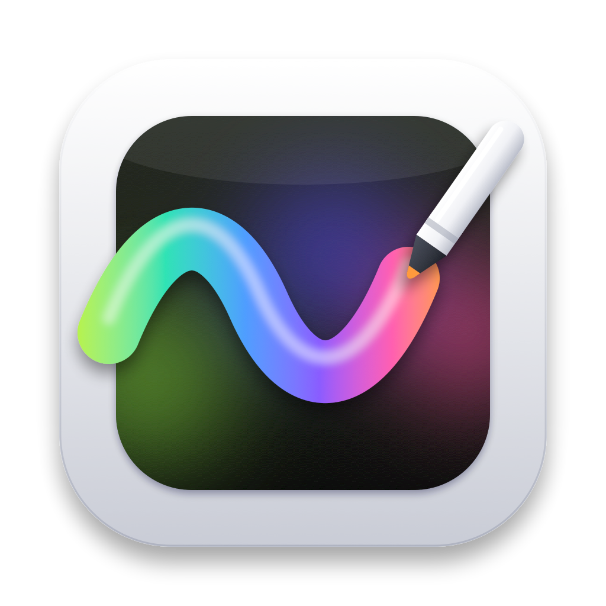

<div align="center">
  
  <h1>Loosa</h1>
  <p>Desenhe em cima da tela do Mac, direto da barra de menus.</p>
  <p>
    <a href="https://github.com/jhoff66/Loosa/releases/latest"></a>
    
    <a href="LICENSE"></a>
  </p>
</div>

O Loosa fica na barra de menus do macOS e, quando você aperta ⌘1, deixa a tela inteira pronta para receber desenho: traço livre, setas, formas, texto, marca-texto e desfoque de área. Serve para gravações, aulas e apresentações, e também para explicar alguma coisa em cima de um print. É grátis, de código aberto, e nada do que passa pela tela é gravado ou enviado para fora do Mac.

## Instalar

Precisa de macOS 14 ou mais recente e roda tanto em Apple Silicon quanto em Intel. O caminho mais curto é colar isto no Terminal:

```sh
curl -fsSL https://raw.githubusercontent.com/jhoff66/Loosa/main/install.sh | bash
```

O script baixa a versão mais recente, copia para Applications e abre o app, que passa a aparecer na barra de menus.

Quem preferir o DMG encontra o `Loosa.dmg` na página de [releases](https://github.com/jhoff66/Loosa/releases/latest) e só precisa arrastar o Loosa para Applications. Como o app não é notarizado pela Apple, o macOS barra a primeira abertura de um DMG baixado pelo navegador, às vezes avisando que o app "está danificado", o que não é verdade. Para liberar, rode uma vez:

```sh
xattr -cr /Applications/Loosa.app
```

## Como usar

Aperte ⌘1, ou clique no ícone do Loosa na barra de menus, e a barra de ferramentas aparece com a tela pronta para desenhar. Escolha a ferramenta, a cor e a espessura, desenhe o que precisar e saia com Esc ou pelo X da barra, lembrando que os desenhos somem na saída. O botão direito no ícone abre o menu, onde ficam as Configurações.

Enquanto o desenho está aberto, cada ferramenta tem uma letra:

| Tecla | Ferramenta | O que faz |
|---|---|---|
| `P` | Desenho livre | Traço à mão |
| `H` | Marca-texto | Faixa verde semitransparente |
| `A` | Seta | Com Shift, trava em ângulos de 45° |
| `R` | Quadrado | Com Shift, sai perfeito |
| `O` | Círculo | Com Shift, sai perfeito |
| `T` | Texto | Enter confirma e Shift+Enter quebra a linha |
| `D` | Desfoque de área | Arraste um retângulo e o que está embaixo fica desfocado |
| `E` | Apagar item | Remove o item inteiro |
| `B` | Borracha livre | Apaga só o pedaço por onde passa |

Três modos ligam e desligam pelo teclado:

| Tecla | Modo | O que faz |
|---|---|---|
| `G` | Traço fantasma | O desenho some sozinho depois de alguns segundos |
| `S` | Suavizar desenho | Corrige o traço livre para não ficar tremido |
| `F` | Preencher formas | Quadrado e círculo saem preenchidos |

E os atalhos gerais:

| Tecla | Função |
|---|---|
| `1` a `6` | Escolhe a cor da posição correspondente |
| `⌘Z` ou `⌃Z` | Desfazer |
| `⇧⌘Z` ou `⇧⌃Z` | Refazer |
| `⌘⌫` | Limpar tudo |
| `Esc` | Sair |

A barra de ferramentas não aparece em prints nem em gravações de tela, de modo que só o desenho vai para o vídeo, e ela pode ser arrastada por qualquer área vazia. Com mais de um monitor ligado, o Loosa cobre todas as telas.

## Desfoque e a permissão de Gravação de Tela

Para desfocar uma área o Loosa precisa ler o que está na tela, e o macOS só permite isso com a permissão de Gravação de Tela. Sem ela o desfoque continua funcionando, mas com um vidro fosco acinzentado no lugar do conteúdo borrado.

1. Abra as Configurações pela engrenagem da barra de ferramentas e, na seção Desfoque, clique em **Liberar…**
2. Em Ajustes do Sistema → Privacidade e Segurança → Gravação de Tela e Áudio do Sistema, ligue o Loosa.
3. Feche e abra o Loosa de novo.

A permissão é usada só para o desfoque.

## Configurações

As Configurações abrem pela engrenagem da barra ou pelo botão direito no ícone, e quase tudo ali pode ser trocado. Dá para esconder as ferramentas que você não usa e mudar a letra de cada uma, clicando na tecla ao lado do nome e apertando a nova (Delete remove o atalho), além de escolher as 6 cores da paleta. O traço fantasma aceita de 1 a 10 segundos, a barra de ferramentas pode ficar embaixo, em cima, à esquerda ou à direita, com tamanho de 80% a 160%, e o atalho global, que vem como ⌘1, aceita qualquer combinação. Também ficam ali a opção de abrir o Loosa ao iniciar o Mac e o botão de restaurar os padrões.

## Compilar

Não precisa do Xcode; bastam as Command Line Tools da Apple (`xcode-select --install`).

```sh
./build.sh           # gera o Loosa.app
./build.sh install   # também copia para /Applications e reabre
./build.sh dmg       # também gera o Loosa.dmg
```

## Licença

MIT. Veja [LICENSE](LICENSE).
